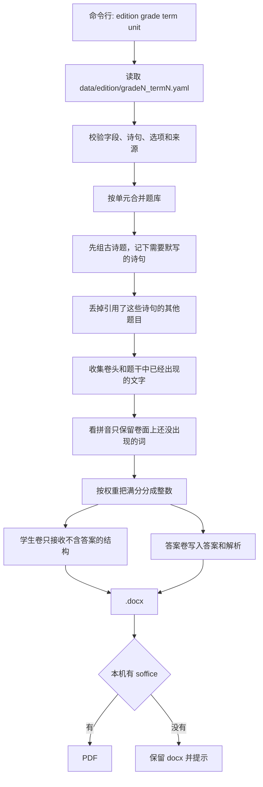

# 小学语文试卷生成器分析结果

## 结论

`cn-exam` 是一个按题库组卷的 Python 命令行工具。输入版本、年级、学期和单元后，写出 A4 学生卷 `.docx` 和单独的答案卷。学生卷渲染路径不接收答案字段。起步题库是人教版（统编版）2026秋新版四年级上册第 1–8 单元。词语表 220 个词、识字表和写字表的单字、各单元日积月累已按课本页录入。单字和日积月累先作数据，当前组卷还不单独出这两类题。期中覆盖第 1–4 单元，期末覆盖第 1–8 单元。

第 1 单元命令：

```bash
cn-exam --edition rj2026 --grade 4 --term 1 --unit 1
```

产物：

- `rj2026_4年级上册_第1单元练习卷_学生卷.docx`
- `rj2026_4年级上册_第1单元练习卷_答案.docx`

有 LibreOffice 时，同目录再写出两份 PDF。

## 组卷流程



## 模块

| 模块 | 职责 |
| --- | --- |
| `cn_exam.cli` | `cn-exam` 参数 |
| `cn_exam.loader` | 读取 YAML 或 JSON，拒绝未定义字段 |
| `cn_exam.assemble` | 抽题、避让已印出的答案、分配分数 |
| `cn_exam.points` | 最大余额法，保证整数且合计为满分 |
| `cn_exam.render_docx` | A4 版式。学生卷入口先转成 `SafeQuestion` |
| `cn_exam.tianzi` | 绘制空田字格，格子里不写汉字 |
| `cn_exam.pdf_export` | 调用 LibreOffice，失败时保留 docx |

默认权重是看拼音 16、古诗 18、选词填空 12、判断与选择 12、阅读 24、习作 18。某个范围没有古诗或没有可用词语时，该题型的权重会分给其余题型。看拼音每词上限 2 分。

种子来自版本、年级、学期和范围的 SHA-256。不传 `--seed` 时，同一命令得到同一份试卷。

## 学生卷隔离

答案不放进学生卷数据结构：

- 题干、选项、田字格个数、习作横线行数属于 `SafeQuestion`。
- `answer`、`explanation`、`hidden_parts` 只在组卷对象里，答案卷才读取。
- 答案行统一以 `答案：` 开头。测试统计这个前缀的次数，必须等于小题数，并且学生卷正文、页眉、页脚里次数为 0。
- 古诗默写的诗句放在 `hidden_parts`。这些汉字不得出现在学生卷；补写题只印前半首。

第 1 单元课文标题印在“范围”一行，因此“观潮”“繁星”不会再当作看拼音的答案。写字表仍为空，所以这一卷暂时没有看拼音和古诗两道大题，页脚说明原因。第 3 单元有三首已核对的七言绝句，会出古诗题，并用未印出的诗中词语出看拼音。

## 起步题库的边界

写入的内容：

- 四个单元的课文标题，与本次项目给定的目录一致。
- 《暮江吟》《题西林壁》《雪梅》全文。教材署名为唐·白居易、宋·苏轼、宋·卢钺。答案卷注明：有的选集把《雪梅》系于卢梅坡名下，本卷与统编教材一致。
- 巴金、安徒生、叶圣陶、法布尔《昆虫记》、孙膑安排田忌赛马并二比一取胜，以及盘古开天地、精卫填海、普罗米修斯取火、女娲炼五色石。神话只考这些稳定情节。

未写入的内容：

- 写字表、词语表、识字表。
- 《现代诗二首》的篇目名称。
- 《夜间飞行的秘密》《方帽子店》的情节和未核对的署名。
- 仍受著作权保护的课文正文。阅读短文和习作在数据里标记为 `original_practice`，卷面写作“自编阅读材料”。

## 版式

- 纸张 A4，页边距左右 18 毫米、上下 16 毫米。
- 卷头含姓名、班级、学号、得分。
- 看拼音和古诗默写使用田字格图片，外框实线、中线虚线，格子中不印字。
- 选词填空和阅读简答使用横线。习作给出横线，并注明写不下可以写在背面。
- 标题和题号使用深蓝色，正文为深色，便于彩色打印，黑白复印时仍可辨认。
- 文档指定中文字体为宋体、黑体。在 Word 或 WPS 中打开即按该字体排版。

## 验证

`pytest` 覆盖：题库校验、三首诗原文逐字比较、各范围满分 100、固定种子可重复、学生卷不含哨兵答案和未出示的诗句、答案卷的 `答案：` 条数等于小题数。

本机安装 LibreOffice 后，第 1 单元学生卷为 2 页 A4，第 3 单元学生卷为 3 页 A4。第 3 单元答案卷含 22 条 `答案：`，与小题数一致。
